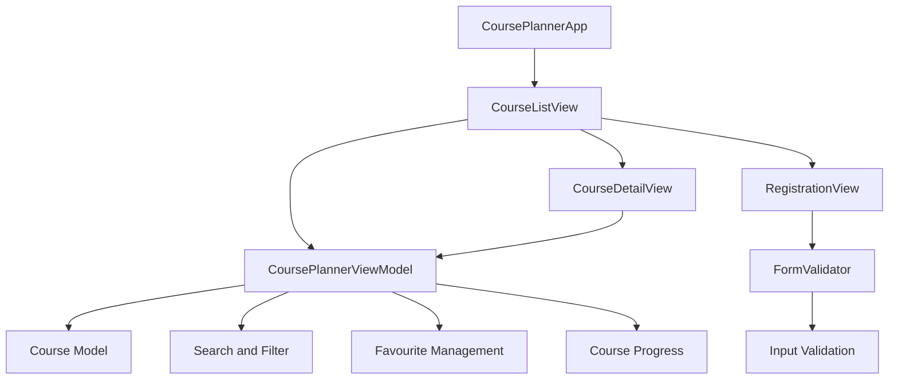

# Course Planner - Architecture Diagram

## Architecture: MVVM

## Component Description

1. **CoursePlannerApp:** Starts the application.
2. **CourseListView:** Displays courses and learning progress.
3. **CourseDetailView:** Shows course details and allows favourite/completed status updates.
4. **RegistrationView:** Collects student information.
5. **CoursePlannerViewModel:** Manages course data, search, favourites and progress.
6. **Course Model:** Stores course information.
7. **FormValidator:** Checks registration inputs.

## Data Flow

- The app opens the Course List screen.
- The ViewModel provides course data to the views.
- Users can search, favourite or complete courses.
- The ViewModel updates the course information.
- RegistrationView uses FormValidator to validate user input.
