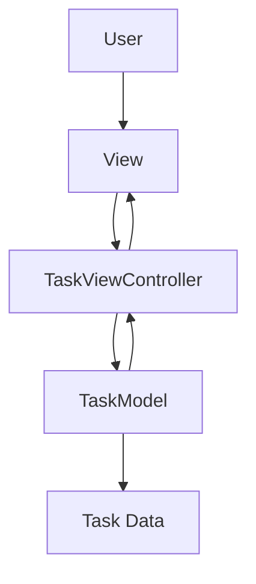
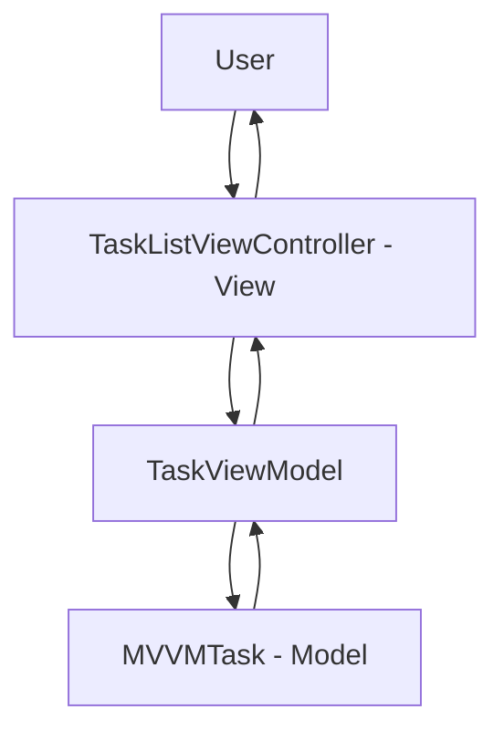

# Lab 4A - Architecture Diagrams

## 1. MVC Architecture



### Flow
1. User interacts with the View.
2. View sends actions to the Controller.
3. Controller calls the Model.
4. Model updates task data.
5. Controller refreshes the View.

## 2. MVVM Architecture



### Flow
1. User interacts with the View.
2. View forwards actions to the ViewModel.
3. ViewModel validates input and performs operations.
4. ViewModel provides updated task information.
5. View refreshes the displayed task list.

## Main Difference

In MVC, the Controller manages communication between the Model and View.

In MVVM, the ViewModel contains presentation-related state and business logic, reducing the responsibility of the View Controller.
```
